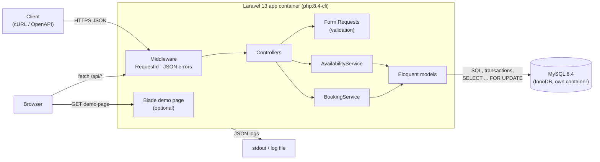
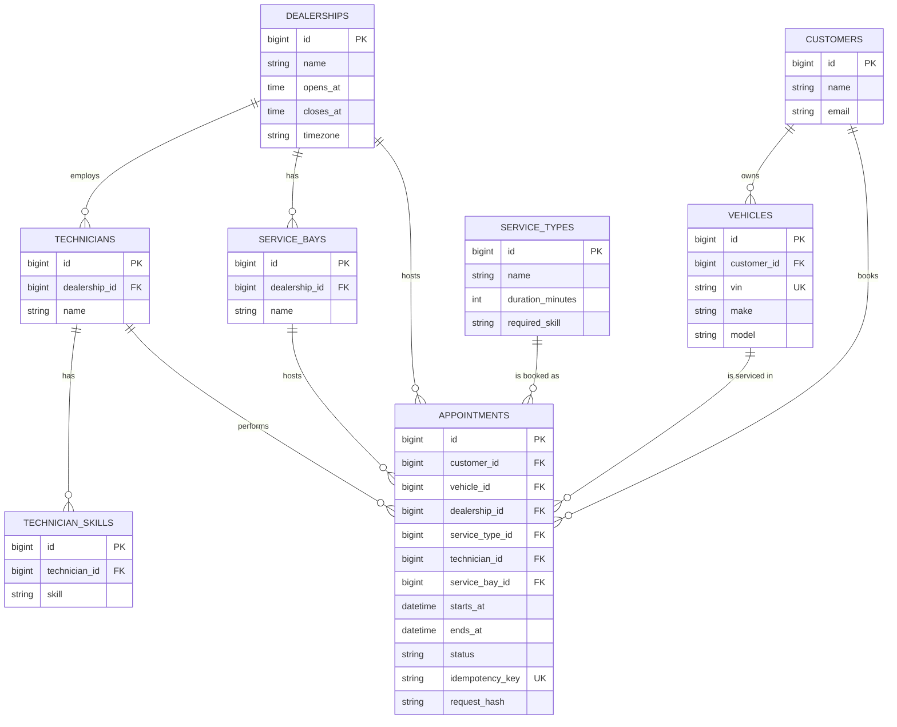
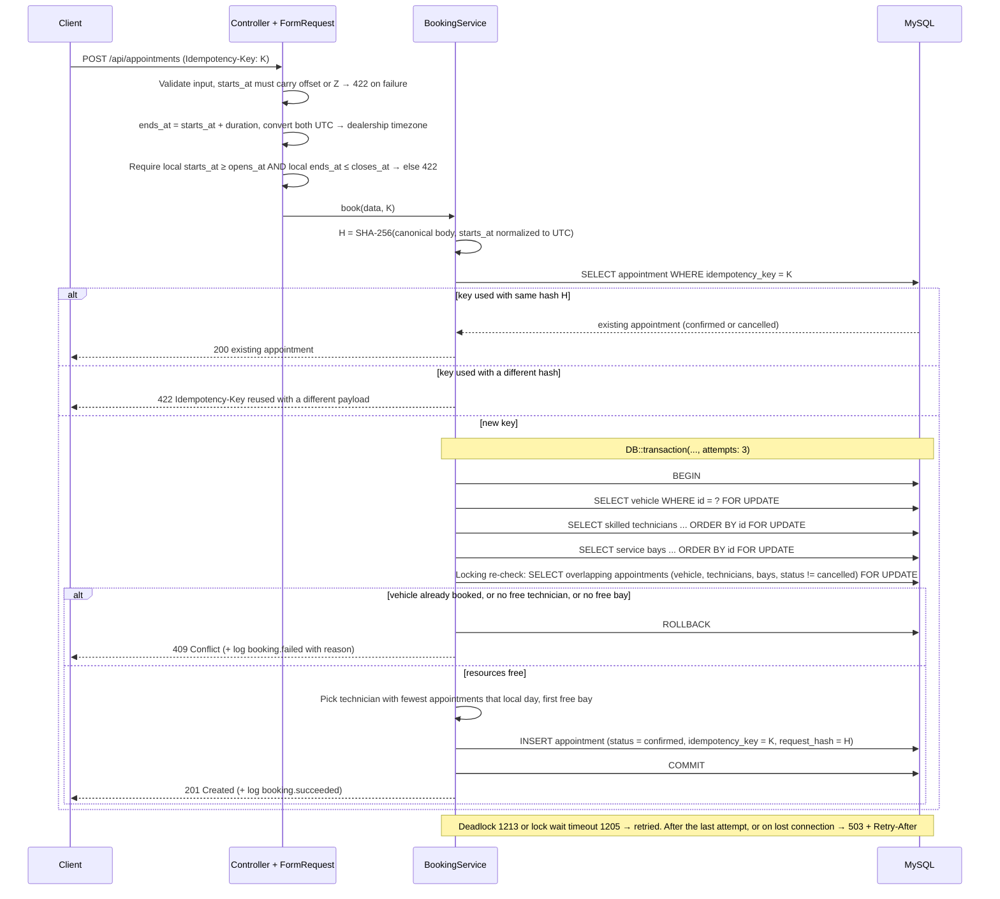

# Unified Service Scheduler — Design

Keyloop Technical Assessment, Scenario A. Backend only: the frontend is replaced by an OpenAPI spec and cURL examples.

## 1. Overview & assumptions

The service lets a customer book a service appointment for a specific vehicle, service type and dealership at a desired time. A booking is confirmed only if a **service bay** and a **technician with the required skill** are both free for the **entire duration** of the service. A confirmed booking is persisted as an `Appointment` linked to the customer, vehicle, technician and service bay.

Assumptions:

- All timestamps are stored in **UTC**. Each dealership has a `timezone`; opening hours and the `date` query parameter are interpreted in that timezone.
- `starts_at` must be **ISO 8601 with an explicit offset or `Z`** (e.g. `2026-11-03T09:00:00+07:00`). A value without an offset is rejected with 422 instead of being guessed.
- **Day boundaries** (for availability and the "fewest appointments that day" rule) are computed as local midnight to midnight in the dealership's timezone, then converted to UTC for queries.
- Bookings start on **30-minute slot** boundaries. A service may span several slots.
- **Opening hours are the same every day, with no overnight shifts** (`opens_at < closes_at` on one local date).
- **Opening-hours check:** `ends_at = starts_at + duration_minutes`. Both instants are converted from UTC to the dealership's `timezone` first, then the booking is valid only if **local `starts_at` >= `opens_at` AND local `ends_at` <= `closes_at`** on that same local date. A service ending exactly at `closes_at` is valid; one ending a minute later is rejected with 422, never truncated.
- Technicians work the dealership's opening hours (no individual shifts, breaks or leave).
- Every bay can handle every service type.
- Two appointments overlap when `new.starts_at < existing.ends_at AND new.ends_at > existing.starts_at`. Cancelled appointments are ignored. The rule applies to technicians, bays and **vehicles**: a vehicle cannot have two overlapping appointments.
- No user authentication or authorization (see §11).

## 2. Architecture diagram

## 3. Components and their roles

| Component | Role |
|---|---|
| `RequestId` middleware | Reads `X-Request-Id` or generates a UUID, adds it to the log context and echoes it in the response header. |
| Form Requests | Validate input shape (`starts_at` ISO 8601 with offset), existence of referenced records and business rules (vehicle belongs to customer, slot alignment, start and end within opening hours in the dealership's timezone, in the future). Failures → 422. |
| Controllers | Thin HTTP layer: map requests to services, services to API Resources and status codes. |
| `AvailabilityService` | For one local date, loads skilled technicians, bays and the dealership's non-cancelled appointments in that day's UTC window (~3 queries), then builds 30-minute slots in memory, applying the same opening-hours rule and keeping slots where at least one skilled technician and one bay are free for the full duration. |
| `BookingService` | Runs the transactional booking: lock vehicle and candidates, locking re-check of overlaps, pick technician and bay, insert appointment, handle idempotency and retries. |
| API Resources | Stable JSON representation of appointments and slots. |
| Blade demo page (optional) | A single simple page that calls the same public REST API (via `fetch`) to show free slots and book an appointment. It is a client test harness only, with no logic of its own; the assessed deliverable is the backend. |
| Exception handler | Renders all errors as JSON (`message`, optional `errors`) with 404 / 409 / 422, and 503 + `Retry-After` for database failures. |

## 4. Data model

Indexes on `appointments`: `(technician_id, starts_at)`, `(service_bay_id, starts_at)`, `(vehicle_id, starts_at)`, unique `idempotency_key` (nullable). `request_hash` is the SHA-256 of the canonicalized request body, stored alongside the key: keys sorted and `starts_at` normalized to UTC first, so `09:00+07:00` and `02:00Z` hash the same. `technician_skills` has a unique `(technician_id, skill)`. `status` is `confirmed` or `cancelled`.

## 5. API endpoints

| Method & path | Purpose | Success | Errors |
|---|---|---|---|
| `GET /api/dealerships/{id}/availability?service_type_id=&date=` | Free start times (UTC + local) for the service on that local date. Exactly one date per request | 200 | 404, 422, 503 |
| `POST /api/appointments` | Book. Body: `customer_id`, `vehicle_id`, `dealership_id`, `service_type_id`, `starts_at` (ISO 8601 with offset or `Z`). Optional `Idempotency-Key` header | 201 (200 on replay) | 404, 409, 422, 503 |
| `GET /api/appointments/{id}` | Fetch one appointment with technician and bay | 200 | 404 |
| `PATCH /api/appointments/{id}/cancel` | Set status to `cancelled`, freeing the resources (no-op if already cancelled) | 200 | 404 |
| `GET /api/health` | Liveness + DB connectivity | 200 / 503 | — |

Replaying an `Idempotency-Key` whose appointment was cancelled afterwards returns **200 with that appointment, `status: cancelled`**; no new booking is created. To rebook, the client sends a new key.

Error codes:

- **422:** invalid input (including `starts_at` without offset), a business rule such as outside opening hours, or `Idempotency-Key reused with a different payload`.
- **404:** unknown resource.
- **409:** no free bay or skilled technician for the requested window, or the vehicle already has an overlapping appointment.
- **503:** deadlock still failing after retries, lock wait timeout or lost DB connection. JSON body with a `Retry-After` header.

## 6. Booking data flow

## 7. Concurrency & consistency

- **Pessimistic locking on parent rows.** Inside a DB transaction the booking locks, with `SELECT ... FOR UPDATE` (`lockForUpdate()`), the vehicle row, then the dealership's candidate `technicians`, then its `service_bays`, each in ascending `id` order. Every booking takes locks in this same order to avoid deadlocks. A second request for the same resources waits until the first commits.
- **The re-check is a locking read.** The availability shown by `GET /availability` is only advisory; the overlap check is repeated after acquiring the locks, and that query also uses `lockForUpdate()`. Under InnoDB's default REPEATABLE READ, a plain `SELECT` reads from the snapshot taken at the transaction's first consistent read. It could therefore miss an appointment that a concurrent transaction committed while this one was waiting for the lock. A locking read always reads the latest committed rows ([MySQL 8.4: Consistent Nonlocking Reads](https://dev.mysql.com/doc/refman/8.4/en/innodb-consistent-read.html)), so two concurrent requests cannot both pass the check.
- **Vehicle overlap.** The same locking re-check covers `vehicle_id`, so one vehicle cannot be double-booked at the same or another dealership (409).
- **Retries and failures.** The booking runs in `DB::transaction(..., attempts: 3)`. Laravel retries the whole transaction on concurrency errors: deadlock (1213) and lock wait timeout (1205). If the last attempt still fails, or the connection is lost, the API returns 503 JSON with `Retry-After` and logs the reason. With MySQL's default 50 s lock wait timeout, a worst-case request can wait several times that before the 503 (tuning is out of scope, §11).
- **Idempotency.** The `Idempotency-Key` is stored on the appointment with a unique index, together with `request_hash`. That hash is the SHA-256 of the canonicalized body, with `starts_at` normalized to UTC.
  - **Same key, same hash:** returns the stored appointment with 200, even if it has since been cancelled.
  - **Same key, different hash:** rejected with 422 `Idempotency-Key reused with a different payload`, so a key can never silently map to a different booking.
  - **Same key racing:** if two requests with the same key run concurrently, the unique constraint rejects the second insert. That error is caught after the rollback, and the same hash comparison decides between 200 and 422.
- Cancellation only flips `status`, so history is preserved and the overlap query simply ignores cancelled rows.

## 8. Technology choices with justifications

| Choice | Why |
|---|---|
| **Laravel 13 (PHP 8.4)** | Batteries included: routing, validation (Form Requests), Eloquent with `lockForUpdate()`, transaction retries, migrations, factories, API Resources, structured logging. Lets the assessment focus on domain logic. |
| **MySQL 8.4 (InnoDB)** | ACID transactions and row-level locks required for safe concurrent booking; widely used and well understood. |
| **Own Dockerfile + Docker Compose (not Laravel Sail)** | Pinned versions: `php:8.4-cli` app image, `mysql:8.4`, PHP dependencies from `composer.lock` installed inside the image. Reviewers need only Docker, no PHP or Composer on the host. One command starts everything: `docker compose up --build`. The app runs `php artisan serve --no-reload` with `PHP_CLI_SERVER_WORKERS` > 1, so parallel requests really run in parallel; a single built-in server worker would serialize them and make the concurrency test meaningless. |
| **Pest** | Already installed in the project; concise, readable test syntax with full Laravel testing helpers. Runs on SQLite for speed (see Testing strategy in §10). |
| **OpenAPI + cURL** | Documents the contract precisely in place of a UI and makes the API easy to try. |

## 9. Observability strategy

- **Structured JSON logs** (Monolog JSON formatter) to stdout, every line carrying `request_id`, method, path, status and duration.
- **Request correlation:** `RequestId` middleware propagates `X-Request-Id` in the log context and response header.
- **Domain events:** `booking.succeeded` (appointment, technician, bay, dealership IDs) and `booking.failed` with a `reason`:
  - `validation_failed`, `outside_opening_hours`, `idempotency_key_mismatch`, `not_found`
  - `vehicle_already_booked`, `no_technician_available`, `no_bay_available`
  - `db_deadlock`, `db_lock_timeout`, `db_unavailable`
- **Health check:** `GET /api/health` runs a trivial DB query; returns 503 if the database is unreachable, for use by load balancers / orchestrators.
- **Future:** Prometheus metrics (booking rate, 409/503 rate, latency histograms, lock wait time) and OpenTelemetry tracing across HTTP and DB spans.

## 10. Scalability, reliability, maintainability

- **Horizontal scaling:** the API is stateless; any number of app instances can run behind a load balancer sharing one database.
- **Query performance:** the `(technician_id, starts_at)`, `(service_bay_id, starts_at)` and `(vehicle_id, starts_at)` indexes keep overlap checks to index range scans. Availability costs ~3 queries per request, whatever the number of slots, technicians or bays, because overlaps are computed in memory. Only one date is accepted per request.
- **Lock contention:** contention is **scoped to a single dealership**. A booking locks all skilled technicians and all bays of its dealership, so concurrent bookings at the same dealership are serialized even when they target different times. Bookings at different dealerships do not block each other, apart from occasional index-gap locks taken by the locking re-check, which the retry absorbs.
- **Reliability:**
  - All booking writes are atomic.
  - Deadlocks and lock timeouts are retried, and persistent DB failures surface as 503 + `Retry-After`.
  - Idempotency keys make client retries safe.
  - The health check enables automatic restarts.
- **Maintainability:** thin controllers, logic in services, validation in Form Requests, tests covering happy paths and every error code.
- **Future:** cache availability per dealership/date (invalidated on book/cancel), push confirmation emails to a queue, read replicas for availability queries.

### Testing strategy

- **Pest unit and feature tests on SQLite** cover:
  - validation (422, including `starts_at` without an offset), 404 and 409 paths, including vehicle overlap;
  - technician and bay selection, and availability;
  - idempotency: same body → 200, different body → 422, replay after cancel → 200 `cancelled`, and `+07:00` vs `Z` producing the same hash;
  - the opening-hours boundary: a service ending exactly at `closes_at` is accepted, one ending a minute later gets 422;
  - seed sanity: after running the database seeder, availability for tomorrow's local date (time frozen in the test) returns at least one bookable slot for at least one seeded dealership and service type, so reviewers can book right away.
- **Concurrency against real MySQL:** SQLite ignores `FOR UPDATE` and locks the whole database, so it cannot reproduce InnoDB row locking. `scripts/concurrency-test` therefore fires many parallel `POST /api/appointments` for the same slot at the Docker Compose stack (MySQL 8.4). It asserts that the number of 201 responses equals the number of free resources, that the rest are 409, and that no overlapping rows exist in the database.

## 11. Out of scope

- Authentication, authorization and multi-tenancy.
- Production frontend UI (replaced by OpenAPI spec and cURL; the optional Blade demo page is only a test harness).
- Technician shifts, breaks, leave and dealership holidays; bay maintenance windows (a future `resource_unavailabilities` table checked in the overlap query).
- `is_active` flags to deactivate technicians or bays.
- Validation of seed data beyond the seed sanity test (CHECK constraints on durations and hours, timezone identifier checks).
- Automated tests on daylight-saving transition dates.
- Tuning `innodb_lock_wait_timeout` (MySQL default kept).
- Narrowing lock scope below the dealership level.
- Bay capabilities / equipment constraints.
- Rescheduling, payments, notifications (email/SMS).
- CRUD for customers, vehicles, dealerships and staff (seeded data only).

## 12. How GenAI was used in the design phase

I used Claude Code (with Laravel Boost for up-to-date Laravel 13 context) as a design collaborator, and a second AI assistant to cross-check its output.

1. **I set the direction first.** Before asking for any text, I wrote down the key decisions myself: data model, API, overlap rule, row locking with a re-check inside the transaction, and idempotency. The AI turned these into the first draft of this document.
2. **I reviewed the gaps it filled.** The AI made six decisions I had not specified. I kept four (lock ordering by id, idempotent cancel, 503 health check, out-of-scope list) and corrected three: it wrote PHPUnit while the project uses Pest; idempotency did not handle the same key with a different payload; and the opening-hours check ignored the end time and the dealership timezone.
3. **I asked the AI to attack its own design.** Acting as a senior reviewer, it listed eight risks. The most important one: under MySQL REPEATABLE READ, a plain SELECT inside the transaction can read an old snapshot, so the overlap re-check could miss a booking committed by another request. I checked this against the MySQL documentation before accepting it, and changed the re-check to a locking read.
4. **I decided what to build and what to defer.** I accepted the fixes that protect correctness (snapshot reads, vehicle double-booking, idempotency hash normalisation, deadlock retries) and moved lower-value items (maintenance schedules, seed validation, DST tests) to Out of scope to keep the solution focused.
5. **I do not rely on AI claims about testing.** SQLite cannot reproduce MySQL locking, so concurrency will be verified with a script that sends parallel requests to a real MySQL instance, not with an in-memory unit test.
