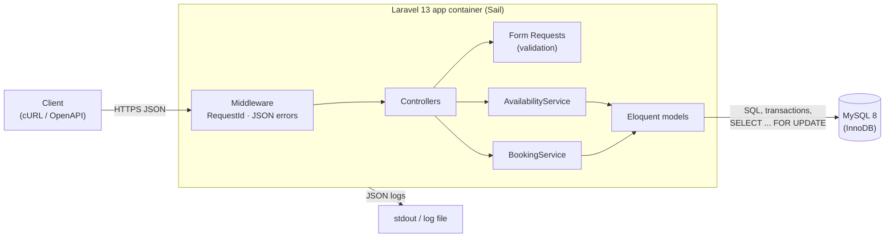
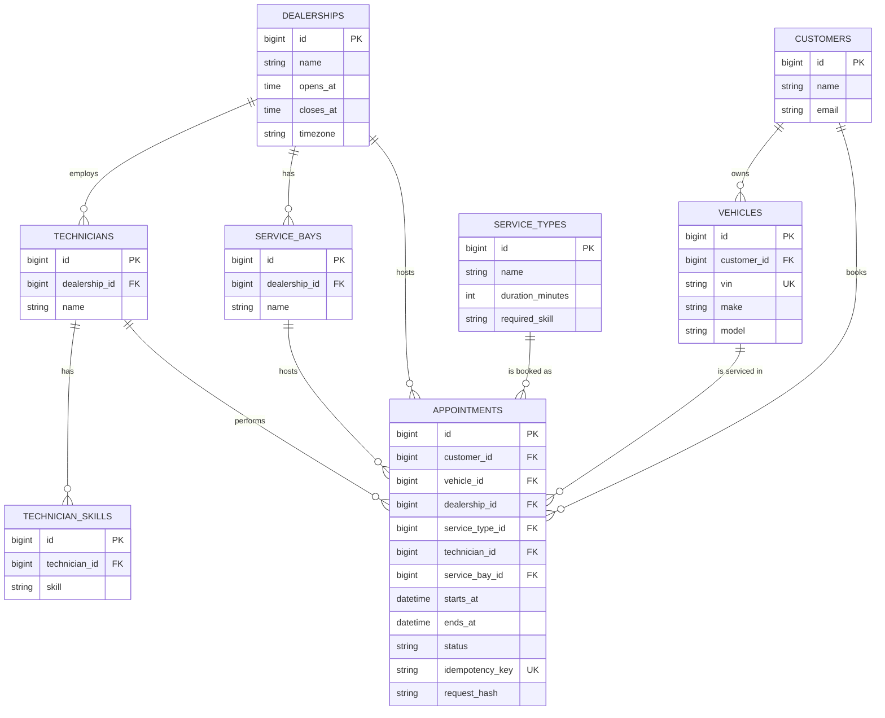
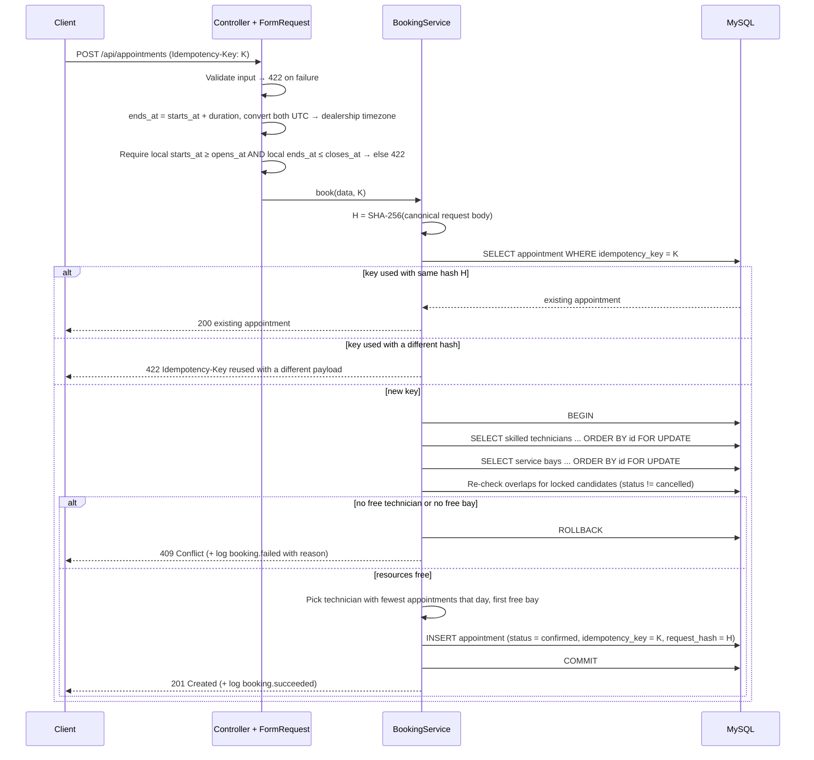

# Unified Service Scheduler — Design

Keyloop Technical Assessment, Scenario A. Backend only: the frontend is replaced by an OpenAPI spec and cURL examples.

## 1. Overview & assumptions

The service lets a customer book a service appointment for a specific vehicle, service type and dealership at a desired time. A booking is confirmed only if a **service bay** and a **technician with the required skill** are both free for the **entire duration** of the service. A confirmed booking is persisted as an `Appointment` linked to the customer, vehicle, technician and service bay.

Assumptions:

- All timestamps are stored in **UTC**. Each dealership has a `timezone`; opening hours and the `date` query parameter are interpreted in that timezone.
- Bookings start on **30-minute slot** boundaries. A service may span several slots.
- **Opening-hours check:** `ends_at = starts_at + duration_minutes`. Both instants are converted from UTC to the dealership's `timezone` first, then the booking is valid only if **local `starts_at` >= `opens_at` AND local `ends_at` <= `closes_at`** on that same local date. A service that would run past closing is rejected with 422, never truncated.
- Technicians work the dealership's opening hours (no individual shifts, breaks or leave).
- Every bay can handle every service type.
- Two appointments overlap when `new.starts_at < existing.ends_at AND new.ends_at > existing.starts_at`. Cancelled appointments are ignored.
- No user authentication or authorization (see §11).

## 2. Architecture diagram

## 3. Components and their roles

| Component | Role |
|---|---|
| `RequestId` middleware | Reads `X-Request-Id` or generates a UUID, adds it to the log context and echoes it in the response header. |
| Form Requests | Validate input shape, existence of referenced records and business rules (vehicle belongs to customer, slot alignment, start and end within opening hours in the dealership's timezone, in the future). Failures → 422. |
| Controllers | Thin HTTP layer: map requests to services, services to API Resources and status codes. |
| `AvailabilityService` | Generates 30-minute candidate slots for a dealership/date, applying the same opening-hours rule (local start >= opens, local end <= closes), and keeps those where at least one skilled technician and one bay are free for the full duration. |
| `BookingService` | Runs the transactional booking: lock candidates, re-check overlaps, pick technician and bay, insert appointment, handle idempotency. |
| API Resources | Stable JSON representation of appointments and slots. |
| Exception handler | Renders all errors as JSON (`message`, optional `errors`) with 404 / 409 / 422 codes. |

## 4. Data model

Indexes on `appointments`: `(technician_id, starts_at)`, `(service_bay_id, starts_at)`, unique `idempotency_key` (nullable). `request_hash` is the SHA-256 of the canonicalized request body (keys sorted), stored alongside the key. `technician_skills` has a unique `(technician_id, skill)`. `status` is `confirmed` or `cancelled`.

## 5. API endpoints

| Method & path | Purpose | Success | Errors |
|---|---|---|---|
| `GET /api/dealerships/{id}/availability?service_type_id=&date=` | Free start times (UTC + local) for the service on that local date | 200 | 404, 422 |
| `POST /api/appointments` | Book. Body: `customer_id`, `vehicle_id`, `dealership_id`, `service_type_id`, `starts_at` (ISO 8601). Optional `Idempotency-Key` header | 201 (200 on replay) | 404, 409, 422 |
| `GET /api/appointments/{id}` | Fetch one appointment with technician and bay | 200 | 404 |
| `PATCH /api/appointments/{id}/cancel` | Set status to `cancelled`, freeing the resources (no-op if already cancelled) | 200 | 404 |
| `GET /api/health` | Liveness + DB connectivity | 200 / 503 | — |

Error codes: **422** invalid input, business rule (e.g. outside opening hours) or `Idempotency-Key reused with a different payload`, **404** unknown resource, **409** no free bay or skilled technician for the requested window.

## 6. Booking data flow

## 7. Concurrency & consistency

- **Pessimistic locking on resource rows.** Inside a DB transaction, the candidate `technicians` and `service_bays` rows for the dealership are locked with `SELECT ... FOR UPDATE` (`lockForUpdate()`), always in ascending `id` order to avoid deadlocks. A second request for the same resources waits until the first commits.
- **Check-then-insert happens inside the lock.** The availability shown by `GET /availability` is only advisory; the overlap check is repeated after acquiring locks, so two concurrent requests cannot both pass it.
- Locking parent rows (rather than relying on range/gap locks over `appointments`) gives a simple, predictable serialization point per resource.
- **Idempotency.** The `Idempotency-Key` is stored on the appointment with a unique index, together with `request_hash` (SHA-256 of the canonicalized body). A replay with the same key and same hash returns the stored appointment with 200; the same key with a different hash is rejected with 422 `Idempotency-Key reused with a different payload`, so a key can never silently map to a different booking. If two requests with the same key race, the unique constraint rejects the second insert; it is caught and the same hash comparison decides between 200 and 422.
- Cancellation only flips `status`, so history is preserved and the overlap query simply ignores cancelled rows.

## 8. Technology choices with justifications

| Choice | Why |
|---|---|
| **Laravel 13 (PHP 8.4)** | Batteries included: routing, validation (Form Requests), Eloquent with `lockForUpdate()`, migrations, factories, API Resources, structured logging. Lets the assessment focus on domain logic. |
| **MySQL 8 (InnoDB)** | ACID transactions and row-level locks required for safe concurrent booking; widely used and well understood. |
| **Docker Compose via Laravel Sail** | One-command, reproducible environment (app + MySQL) for reviewers. |
| **Pest** | Already installed in the project; concise, readable test syntax with full Laravel testing helpers. Feature tests hit real HTTP endpoints against a real MySQL database, including a concurrency test. |
| **OpenAPI + cURL** | Documents the contract precisely in place of a UI and makes the API easy to try. |

## 9. Observability strategy

- **Structured JSON logs** (Monolog JSON formatter) to stdout, every line carrying `request_id`, method, path, status and duration.
- **Request correlation:** `RequestId` middleware propagates `X-Request-Id` in the log context and response header.
- **Domain events:** `booking.succeeded` (appointment, technician, bay, dealership IDs) and `booking.failed` with a `reason` (`validation_failed`, `outside_opening_hours`, `idempotency_key_mismatch`, `no_technician_available`, `no_bay_available`, `not_found`).
- **Health check:** `GET /api/health` runs a trivial DB query; returns 503 if the database is unreachable, for use by load balancers / orchestrators.
- **Future:** Prometheus metrics (booking rate, 409 rate, latency histograms, lock wait time) and OpenTelemetry tracing across HTTP and DB spans.

## 10. Scalability, reliability, maintainability

- **Horizontal scaling:** the API is stateless; any number of app instances can run behind a load balancer sharing one database.
- **Query performance:** `(technician_id, starts_at)` and `(service_bay_id, starts_at)` indexes keep overlap checks to index range scans.
- **Lock granularity:** locks are per technician/bay, so bookings at different dealerships never block each other; contention is limited to the same dealership and time.
- **Reliability:** all booking writes are atomic; idempotency keys make client retries safe; health check enables automatic restarts.
- **Maintainability:** thin controllers, logic in services, validation in Form Requests, feature tests covering happy paths, every error code and concurrent booking.
- **Future:** cache availability per dealership/date (invalidated on book/cancel), push confirmation emails to a queue, read replicas for availability queries.

## 11. Out of scope

- Authentication, authorization and multi-tenancy.
- Frontend UI (replaced by OpenAPI spec and cURL).
- Technician shifts, breaks, leave and dealership holidays.
- Bay capabilities / equipment constraints.
- Rescheduling, payments, notifications (email/SMS).
- CRUD for customers, vehicles, dealerships and staff (seeded data only).

## 12. How GenAI was used in the design phase

<!-- To be written by the author. -->
